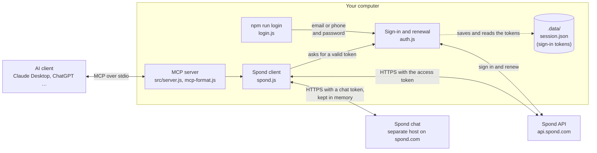

<p align="center"></p>

<h1 align="center">Spond MCP</h1>

<p align="center">
  <a href="https://github.com/kristoffervp/spond-mcp/actions/workflows/test.yml"></a>
  <a href="https://github.com/kristoffervp/spond-mcp/releases"></a>
  <a href="LICENSE"></a>
</p>

<p align="center">English · <a href="README.no.md">Norsk</a></p>

A local, read-only MCP server that lets an AI client read your Spond events, group wall posts and chats. It can't answer invitations, send messages or change anything in Spond.

**Unofficial.** Not made by or affiliated with Spond AS. It uses undocumented endpoints that can change without notice.

## Quick start

You need Node.js 20 or later.

```sh
git clone https://github.com/kristoffervp/spond-mcp.git
cd spond-mcp
npm install
npm run login
```

`npm run login` asks for your Spond email or phone number and password, and `npm test` checks the server without using your account. Then add the server to your AI client as a local (stdio) server. For Claude Desktop, in `claude_desktop_config.json`:

```json
{
  "mcpServers": {
    "spond": {
      "command": "node",
      "args": ["/full/path/to/spond-mcp/src/server.js"]
    }
  }
}
```

## Tools

| Tool | What it does |
| --- | --- |
| `list_family` | You and the children you answer for, with their groups and subgroups |
| `list_groups` | Groups with subgroups, activity, club, contact person, member count and which family members belong. No member lists |
| `list_events` | Events with times, meetup, location and your family's responses. `from_date` and `to_date` (`YYYY-MM-DD`) default to today and the next 14 days, at most 366 days. Filters: `group_id`, `only_unanswered` |
| `get_event` | One event with description, organizers, comments and your family's responses |
| `list_posts` | Recent group wall posts with comments, up to `limit` (1 to 50, default 20). Filter: `group_id`. `include_images` adds image links |
| `list_chats` | Recent chats, also group chats you follow as a guardian, with the time, number (`newestNum`) and an excerpt of the newest message. Up to `limit` (1 to 50, default 20) |
| `get_chat` | The newest messages in one chat, oldest first, up to `limit` (1 to 50, default 20). `max_num` reads further back. `include_images` adds image links |

Each event shows every family member's response (`accepted`, `declined`, `unanswered`, `waiting_list`, `unconfirmed` or `unknown`) and counts the responses of everyone invited. Times are local, with the offset of your Spond profile's time zone, for example `2026-10-10T12:15+02:00`. Lists return at most 50 entries, and long text is shortened and marked. Results are returned as `structuredContent` and as JSON text, both marked as untrusted content from Spond.

`asGuardian` marks chats you follow on behalf of a child, which is where parents' group chats usually are. When a chat has older messages, `get_chat` returns `olderBefore`, a number to pass as `max_num`. `fromFamily` marks messages from you or another guardian of your children. Deleted messages have no text.

## How it works

The server runs on your computer and talks to the AI client over stdio. It uses the sign-in from `npm run login`, saved in `.data/`.



## Configuration

Set this in the client config (and in Terminal for `npm run login`):

| Variable | Default | Purpose |
| --- | --- | --- |
| `SPOND_DATA_DIR` | `.data` in this folder | Where the sign-in is saved |

## Troubleshooting

- **"No Spond sign-in found" or "The Spond sign-in has expired".** Run `npm run login` again. The refresh token lasts 90 days and restarts with every renewal, so this happens after 90 days without use or when Spond ends the session.
- **"This Spond account requires two-factor verification".** Accounts with two-factor verification are not supported yet.
- **"Spond is limiting requests".** Wait a few minutes. Spond has blocked IP addresses that sign in too often, so don't run `npm run login` over and over.
- **The sign-in stops working after `.data/` was copied to another computer.** Each renewal replaces the refresh token, so two copies can't both stay signed in. Run `npm run login` on each computer.
- **"The Spond response is too large".** Narrow the request with `group_id`, a shorter date range or a lower `limit`.
- **The client can't start the server.** Use full paths for both `node` (from `command -v node`) and `src/server.js`.
- **Group changes don't show up.** Profile and groups are cached for five minutes.

## Security and privacy

- The server runs on your computer and opens no network port. Any AI client you connect can still read your Spond events, posts and chats, and a cloud AI service receives what the client reads. Decide what you are willing to share.
- Text from Spond is passed on as information, not instructions. That can't stop every attempt to steer the AI. Use clients you trust and review tool calls.
- Spond's group data includes other people's children and their guardians. The server returns other people by name only, and never returns phone numbers, email addresses, birth dates or member lists. Responses are shown per person only for your own family. Chats show the number of participants, not who they are.
- Image links are returned only with `include_images: true`, because anyone with the link can open the image without signing in.
- The password is read without echo and never saved. `.data/session.json` holds tokens that give access to your Spond account. Never share it, and delete it to remove the sign-in.
- Requests go only to `api.spond.com` and to a chat host on `spond.com` over HTTPS, and redirects are not followed. Errors shown to the client never include tokens or personal data.
- To report a vulnerability, see [SECURITY.md](SECURITY.md).

## Changelog

See [CHANGELOG.md](CHANGELOG.md) and [Releases](https://github.com/kristoffervp/spond-mcp/releases).

## License

[0BSD](LICENSE): use, change and share it freely, also commercially, without attribution. It does not cover the Spond service or its data.
