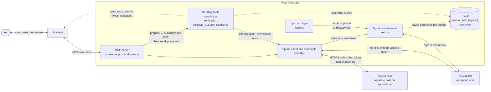

<p align="center"></p>

<h1 align="center">Spond MCP</h1>

<p align="center">
  <a href="https://github.com/kristoffervp/spond-mcp/actions/workflows/test.yml"></a>
  <a href="https://github.com/kristoffervp/spond-mcp/releases"></a>
  <a href="LICENSE"></a>
</p>

<p align="center">English · <a href="README.no.md">Norsk</a></p>

A local MCP server that lets an AI client read your Spond events, group wall posts, polls and chats. By default it only reads. With sending turned on, it can also answer events, vote in polls, take on volunteer tasks, comment on events and posts, write in chats you are in, and mark chats and posts as read.

**Unofficial.** Not made by or affiliated with Spond AS. It uses undocumented endpoints that can change without notice.

## Quick start

You need Node.js 20 or later.

```sh
git clone https://github.com/kristoffervp/spond-mcp.git
cd spond-mcp
npm run login
```

`npm run login` asks for your Spond email or phone number and password, and `npm test` checks the server without using your account. Then add the server to your AI client as a local (stdio) server. For Claude Desktop, in `claude_desktop_config.json`:

```json
{
  "mcpServers": {
    "spond": {
      "command": "node",
      "args": ["/full/path/to/spond-mcp/src/server.js"]
    }
  }
}
```

## Tools

| Tool | What it does |
| --- | --- |
| `list_family` | You and the children you answer for, with their groups and subgroups |
| `list_groups` | Groups with subgroups, activity, club, contact person, member count and which family members belong. No member lists |
| `list_events` | Events with times, meetup, location and your family's responses. `from_date` and `to_date` (`YYYY-MM-DD`) default to today and the next 14 days, at most 366 days. Filters: `group_id`, `only_unanswered` |
| `get_event` | One event with description, organizers, comments, volunteer tasks and your family's responses |
| `list_posts` | Recent group wall posts with comments, up to `limit` (1 to 50, default 20). Filter: `group_id`. `include_images` adds image links |
| `list_chats` | Recent chats, also group chats you follow as a guardian, with the time, number (`newestNum`) and an excerpt of the newest message. Up to `limit` (1 to 50, default 20) |
| `get_chat` | The newest messages in one chat, oldest first, up to `limit` (1 to 50, default 20). `max_num` reads further back. `include_images` adds image links |
| `list_polls` | Recent polls with options, vote counts, the deadline and what your family members voted. Others are counted, not named. Filter: `group_id` |

Each event shows every family member's response (`accepted`, `declined`, `unanswered`, `waiting_list`, `unconfirmed` or `unknown`) and counts the responses of everyone invited. Times are local, with the offset of your Spond profile's time zone, for example `2026-10-10T12:15+02:00`. Lists return at most 50 entries, and long text is shortened and marked. Results are returned as `structuredContent` and as JSON text, both marked as untrusted content from Spond.

`asGuardian` marks chats you follow on behalf of a child, which is where parents' group chats usually are. When a chat has older messages, `get_chat` returns `olderBefore`, a number to pass as `max_num`. `fromFamily` marks messages from you or another guardian of your children. Deleted messages have no text.

## Sending (opt-in, not yet tested against Spond)

Set `SPOND_ALLOW_SEND=1` (in `"env"` in the client config) to add these tools:

| Tool | What it does |
| --- | --- |
| `prepare_event_response` | Prepares yes or no to an event for a family member (`member`, a first or full name, if several are invited), with an optional `reason` of at most 100 characters when declining |
| `prepare_poll_vote` | Prepares a vote in a poll for a family member, or with `vote: false` removes one |
| `prepare_task_response` | Prepares taking on or giving up a volunteer task on an event (baking, driving) for a family member or yourself |
| `prepare_comment` | Prepares a comment on an event or post, or a reply to one of its comments |
| `prepare_chat_message` | Prepares a text message in a chat you take part in |
| `send_prepared` | Sends what a prepare tool prepared |
| `mark_chat_read` | Marks a chat as read up to its newest message |
| `mark_posts_read` | Marks up to 20 posts as read |

- Everything except mark read takes two steps. A prepare tool checks the request and returns exactly what would be sent, a one-line `summary` and a one-time code; nothing has been sent at that point. `send_prepared` needs the code and the same `summary`, so the client's approval prompt shows what is sent. The code works once, expires after 10 minutes and belongs to the running server: a restarted server has forgotten it. Just before sending, the server checks the target again and refuses if anything in the preview changed. Afterwards it reports whether Spond shows the result. Everything sent or attempted is logged in `.data/sent.jsonl`.
- If the client supports it (MCP elicitation), you confirm each send and each mark read in the client's own dialog. Chat messages and comments are only sent with that dialog, because they reach many people with text the AI wrote; `SPOND_ALLOW_SEND_NO_DIALOG=1` allows them without it. For the rest, a client without the dialog has its tool approval as the only check: never choose "Always allow" for `send_prepared`, `mark_chat_read` or `mark_posts_read`.
- If Spond does not answer after a send, the server says it may have been sent. Check in Spond before preparing it again.
- The same rules as Spond's web client: no answers to cancelled or finished events, events with a payment, or after attendance is registered; no yes after the answer deadline unless a spot is offered from the waiting list; no change of an answer after the deadline. A prepare tool warns when a yes puts the child on the waiting list, or a no gives up a spot. Tasks follow the same rules: no changes once the event has started or after the answer deadline, and no taking a full task.
- Messages and comments are at most 2,000 characters, with invisible characters removed. The preview, and the start of the `summary`, show how many people get or can read it and the whole text, with a warning above 30 people: the chat's participants (and guardians of children in it), everyone invited to an event, or the post's group. Messages go only to existing chats you are a participant in, not to chats you only follow as a guardian.
- Mark read needs no code, but is confirmed like a send. It can't be undone.
- The endpoints come from Spond's web client and have not been tested against a real account yet. Check the result in the Spond app the first times.
- A post or chat can contain text meant to make the AI client answer or write for you, for example to a large group. Read the preview, and leave sending off when you don't need it.

## How it works

The server runs on your computer and talks to the AI client over stdio. It uses the sign-in from `npm run login`, saved in `.data/`.



## Configuration

Set this in the client config (and in Terminal for `npm run login`):

| Variable | Default | Purpose |
| --- | --- | --- |
| `SPOND_DATA_DIR` | `.data` in this folder | Where the sign-in and the log of sent items are saved |
| `SPOND_ALLOW_SEND` | off | `1` adds the tools that answer, vote, take tasks, comment, write in chats and mark as read (see Sending) |
| `SPOND_ALLOW_SEND_NO_DIALOG` | off | `1` sends chat messages and comments also from clients that can't show the confirmation dialog |

## Troubleshooting

- **"No Spond sign-in found" or "The Spond sign-in has expired".** Run `npm run login` again. The refresh token lasts 90 days and restarts with every renewal, so this happens after 90 days without use or when Spond ends the session.
- **"This Spond account requires two-factor verification".** Accounts with two-factor verification are not supported yet.
- **"Spond chat refused access".** The chat host turned down a fresh chat token. Try again later; the sign-in itself still works, so don't sign in again.
- **"Spond is limiting requests".** Wait a few minutes. Spond has blocked IP addresses that sign in too often, so don't run `npm run login` over and over.
- **The sign-in stops working after `.data/` was copied to another computer.** Each renewal replaces the refresh token, so two copies can't both stay signed in. Run `npm run login` on each computer.
- **"The Spond response is too large".** Narrow the request with `group_id`, a shorter date range or a lower `limit`.
- **The client can't start the server.** Use full paths for both `node` (from `command -v node`) and `src/server.js`.
- **Group changes don't show up.** Profile and groups are cached for five minutes.

## Security and privacy

- The server runs on your computer and opens no network port. Any AI client you connect can still read your Spond events, posts and chats, and a cloud AI service receives what the client reads. Decide what you are willing to share.
- Text from Spond is passed on as information, not instructions. That can't stop every attempt to steer the AI. Use clients you trust and review tool calls.
- Spond's group data includes other people's children and their guardians. The server returns other people by name only, and never returns phone numbers, email addresses, birth dates or member lists. Responses are shown per person only for your own family. Chats show the number of participants, not who they are; only a direct message preview names the other person. Tasks name only your family; others are counted.
- Image links are returned only with `include_images: true`, because anyone with the link can open the image without signing in.
- The password is read without echo and never saved. `.data/session.json` holds tokens that give access to your Spond account. Never share it, and delete it to remove the sign-in.
- Requests go only to `api.spond.com` and to a chat host on `spond.com` over HTTPS, and redirects are not followed. Errors shown to the client never include tokens or personal data. Invisible characters that can hide instructions from you but not from the AI are removed from all text.
- To report a vulnerability, see [SECURITY.md](SECURITY.md).

## Changelog

See [CHANGELOG.md](CHANGELOG.md) and [Releases](https://github.com/kristoffervp/spond-mcp/releases).

## License

[0BSD](LICENSE): use, change and share it freely, also commercially, without attribution. It does not cover the Spond service or its data.
