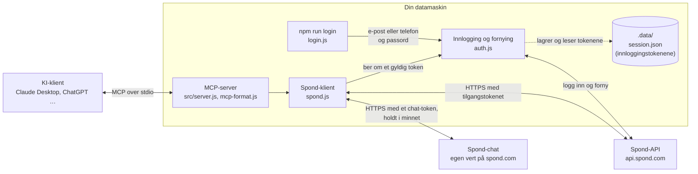

<h1 align="center">Spond MCP</h1>

<p align="center">
  <a href="https://github.com/kristoffervp/spond-mcp/actions/workflows/test.yml"></a>
  <a href="https://github.com/kristoffervp/spond-mcp/releases"></a>
  <a href="LICENSE"></a>
</p>

<p align="center">Norsk · <a href="README.md">English</a></p>

En lokal MCP-server med bare lesetilgang, som lar en KI-klient lese arrangementene, innleggene på gruppeveggen og chattene dine i Spond. Den kan ikke svare på invitasjoner, sende meldinger eller endre noe i Spond.

**Uoffisiell.** Ikke laget av eller knyttet til Spond AS. Den bruker udokumenterte endepunkter som kan endres uten varsel.

## Kom i gang

Du trenger Node.js 20 eller nyere.

```sh
git clone https://github.com/kristoffervp/spond-mcp.git
cd spond-mcp
npm install
npm run login
```

`npm run login` spør etter e-postadressen eller telefonnummeret og passordet du bruker i Spond, og `npm test` sjekker serveren uten å bruke kontoen din. Legg så til serveren i KI-klienten som en lokal (stdio) server. For Claude Desktop, i `claude_desktop_config.json`:

```json
{
  "mcpServers": {
    "spond": {
      "command": "node",
      "args": ["/full/sti/til/spond-mcp/src/server.js"]
    }
  }
}
```

## Verktøy

| Verktøy | Hva det gjør |
| --- | --- |
| `list_family` | Deg og barna du svarer for, med gruppene og undergruppene deres |
| `list_groups` | Grupper med undergrupper, aktivitet, klubb, kontaktperson, antall medlemmer og hvilke familiemedlemmer som er med. Ingen medlemslister |
| `list_events` | Arrangementer med tidspunkt, oppmøte, sted og familiens svar. `from_date` og `to_date` (`YYYY-MM-DD`) er som standard i dag og de neste 14 dagene, høyst 366 dager. Filtre: `group_id`, `only_unanswered` |
| `get_event` | Ett arrangement med beskrivelse, arrangører, kommentarer og familiens svar |
| `list_posts` | Nye innlegg på gruppeveggen med kommentarer, inntil `limit` (1 til 50, standard 20). Filter: `group_id`. `include_images` gir også bildelenker |
| `list_chats` | Nye chatter, også gruppechatter du følger som foresatt, med tidspunkt, nummer (`newestNum`) og et utdrag av den nyeste meldingen. Inntil `limit` (1 til 50, standard 20) |
| `get_chat` | De nyeste meldingene i én chat, eldste først, inntil `limit` (1 til 50, standard 20). `max_num` leser lenger bakover. `include_images` gir også bildelenker |

Hvert arrangement viser svaret til hvert familiemedlem (`accepted`, `declined`, `unanswered`, `waiting_list`, `unconfirmed` eller `unknown`) og antall svar fra alle inviterte. Tidspunkter er lokale, med UTC-forskyvningen for tidssonen i Spond-profilen din, for eksempel `2026-10-10T12:15+02:00`. Lister gir høyst 50 elementer, og lange tekster forkortes og merkes. Svarene kommer som `structuredContent` og som JSON-tekst, begge merket som ikke-betrodd innhold fra Spond.

`asGuardian` merker chatter du følger på vegne av et barn, og det er der foreldrenes gruppechatter vanligvis ligger. Når en chat har eldre meldinger, gir `get_chat` `olderBefore`, et nummer du kan sende som `max_num`. `fromFamily` merker meldinger fra deg eller en annen foresatt til barna dine. Slettede meldinger har ingen tekst.

## Slik virker det

Serveren kjører på datamaskinen din og snakker med KI-klienten over stdio. Den bruker innloggingen fra `npm run login`, som er lagret i `.data/`.



## Innstillinger

Settes i klientoppsettet (og i Terminal for `npm run login`):

| Variabel | Standard | Brukes til |
| --- | --- | --- |
| `SPOND_DATA_DIR` | `.data` i denne mappen | Hvor innloggingen lagres |

## Feilsøking

- **«No Spond sign-in found» eller «The Spond sign-in has expired».** Kjør `npm run login` på nytt. Fornyelsestokenet varer i 90 dager og starter på nytt ved hver fornying, så dette skjer etter 90 dager uten bruk eller når Spond avslutter økten.
- **«This Spond account requires two-factor verification».** Kontoer med totrinnsbekreftelse støttes ikke ennå.
- **«Spond is limiting requests».** Vent noen minutter. Spond har blokkert IP-adresser som logger inn for ofte, så ikke kjør `npm run login` gang på gang.
- **Innloggingen slutter å virke etter at `.data/` er kopiert til en annen datamaskin.** Hver fornying bytter ut fornyelsestokenet, så to kopier kan ikke begge forbli innlogget. Kjør `npm run login` på hver datamaskin.
- **«The Spond response is too large».** Snevre inn forespørselen med `group_id`, en kortere periode eller en lavere `limit`.
- **Klienten får ikke startet serveren.** Bruk hele stien til både `node` (fra `command -v node`) og `src/server.js`.
- **Endringer i grupper vises ikke.** Profil og grupper mellomlagres i fem minutter.

## Sikkerhet og personvern

- Serveren kjører på din datamaskin og åpner ingen nettverksport. En KI-klient du kobler til, kan likevel lese arrangementene, innleggene og chattene dine i Spond, og en KI-tjeneste i skyen får det klienten leser. Vurder selv hva du vil dele.
- Tekst fra Spond sendes videre som informasjon, ikke instruksjoner. Det kan ikke stoppe alle forsøk på å styre KI-en. Bruk klienter du stoler på, og se over verktøykallene.
- Gruppedataene i Spond inneholder andres barn og deres foresatte. Serveren viser andre personer bare med navn, og gir aldri telefonnumre, e-postadresser, fødselsdatoer eller medlemslister. Svar vises per person bare for din egen familie. Chatter viser antall deltakere, ikke hvem de er.
- Bildelenker kommer bare med `include_images: true`, fordi alle som har lenken, kan åpne bildet uten å logge inn.
- Passordet vises ikke mens du skriver, og lagres aldri. `.data/session.json` inneholder tokener som gir tilgang til Spond-kontoen din. Del den aldri, og slett den for å fjerne innloggingen.
- Forespørsler går bare til `api.spond.com` og til en chat-vert på `spond.com` over HTTPS, og omdirigeringer følges ikke. Feilmeldinger klienten får, inneholder aldri tokener eller personopplysninger.
- Se [SECURITY.md](SECURITY.md) for å melde fra om sikkerhetshull.

## Endringslogg

Se [CHANGELOG.no.md](CHANGELOG.no.md) og [Releases](https://github.com/kristoffervp/spond-mcp/releases).

## Lisens

[0BSD](LICENSE): bruk, endre og del fritt, også kommersielt, uten krav om kreditering. Lisensen gjelder ikke Spond-tjenesten eller innholdet der.
