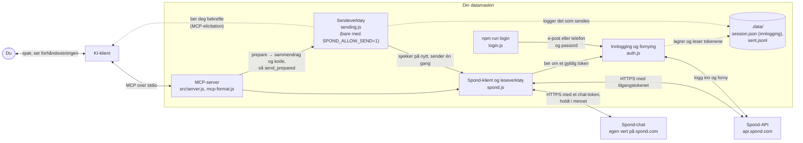

<p align="center"></p>

<h1 align="center">Spond MCP</h1>

<p align="center">
  <a href="https://github.com/kristoffervp/spond-mcp/actions/workflows/test.yml"></a>
  <a href="https://github.com/kristoffervp/spond-mcp/releases"></a>
  <a href="LICENSE"></a>
</p>

<p align="center">Norsk · <a href="README.md">English</a></p>

En lokal MCP-server som lar en KI-klient lese arrangementene, innleggene på gruppeveggen, avstemningene og chattene dine i Spond. Som standard leser den bare. Med sending slått på kan den også svare på arrangementer, stemme i avstemninger og merke chatter og innlegg som lest. Den kan ikke sende meldinger.

**Uoffisiell.** Ikke laget av eller knyttet til Spond AS. Den bruker udokumenterte endepunkter som kan endres uten varsel.

## Kom i gang

Du trenger Node.js 20 eller nyere.

```sh
git clone https://github.com/kristoffervp/spond-mcp.git
cd spond-mcp
npm run login
```

`npm run login` spør etter e-postadressen eller telefonnummeret og passordet du bruker i Spond, og `npm test` sjekker serveren uten å bruke kontoen din. Legg så til serveren i KI-klienten som en lokal (stdio) server. For Claude Desktop, i `claude_desktop_config.json`:

```json
{
  "mcpServers": {
    "spond": {
      "command": "node",
      "args": ["/full/sti/til/spond-mcp/src/server.js"]
    }
  }
}
```

## Verktøy

| Verktøy | Hva det gjør |
| --- | --- |
| `list_family` | Deg og barna du svarer for, med gruppene og undergruppene deres |
| `list_groups` | Grupper med undergrupper, aktivitet, klubb, kontaktperson, antall medlemmer og hvilke familiemedlemmer som er med. Ingen medlemslister |
| `list_events` | Arrangementer med tidspunkt, oppmøte, sted og familiens svar. `from_date` og `to_date` (`YYYY-MM-DD`) er som standard i dag og de neste 14 dagene, høyst 366 dager. Filtre: `group_id`, `only_unanswered` |
| `get_event` | Ett arrangement med beskrivelse, arrangører, kommentarer og familiens svar |
| `list_posts` | Nye innlegg på gruppeveggen med kommentarer, inntil `limit` (1 til 50, standard 20). Filter: `group_id`. `include_images` gir også bildelenker |
| `list_chats` | Nye chatter, også gruppechatter du følger som foresatt, med tidspunkt, nummer (`newestNum`) og et utdrag av den nyeste meldingen. Inntil `limit` (1 til 50, standard 20) |
| `get_chat` | De nyeste meldingene i én chat, eldste først, inntil `limit` (1 til 50, standard 20). `max_num` leser lenger bakover. `include_images` gir også bildelenker |
| `list_polls` | Nye avstemninger med alternativer, antall stemmer, fristen og hva familiemedlemmene dine har stemt. Andre telles, men navngis ikke. Filter: `group_id` |

Hvert arrangement viser svaret til hvert familiemedlem (`accepted`, `declined`, `unanswered`, `waiting_list`, `unconfirmed` eller `unknown`) og antall svar fra alle inviterte. Tidspunkter er lokale, med UTC-forskyvningen for tidssonen i Spond-profilen din, for eksempel `2026-10-10T12:15+02:00`. Lister gir høyst 50 elementer, og lange tekster forkortes og merkes. Svarene kommer som `structuredContent` og som JSON-tekst, begge merket som ikke-betrodd innhold fra Spond.

`asGuardian` merker chatter du følger på vegne av et barn, og det er der foreldrenes gruppechatter vanligvis ligger. Når en chat har eldre meldinger, gir `get_chat` `olderBefore`, et nummer du kan sende som `max_num`. `fromFamily` merker meldinger fra deg eller en annen foresatt til barna dine. Slettede meldinger har ingen tekst.

## Sending (valgfritt, ikke testet mot Spond ennå)

Sett `SPOND_ALLOW_SEND=1` (i `"env"` i klientoppsettet) for å få disse verktøyene:

| Verktøy | Hva det gjør |
| --- | --- |
| `prepare_event_response` | Forbereder ja eller nei til et arrangement for et familiemedlem (`member`, fornavn eller fullt navn, hvis flere er invitert), med en valgfri `reason` på høyst 100 tegn ved nei |
| `prepare_poll_vote` | Forbereder en stemme i en avstemning for et familiemedlem, eller fjerner en med `vote: false` |
| `send_prepared` | Sender det et forberedelsesverktøy har forberedt |
| `mark_chat_read` | Merker en chat som lest til og med den nyeste meldingen |
| `mark_posts_read` | Merker inntil 20 innlegg som lest |

- Svar og stemmer tar to steg. Et forberedelsesverktøy sjekker forespørselen og gir nøyaktig det som vil bli sendt, et sammendrag på én linje (`summary`) og en engangskode; ingenting er sendt da. `send_prepared` trenger koden og det samme sammendraget, så klientens godkjenning viser hva som sendes. Koden virker én gang, går ut etter 10 minutter og hører til serveren som kjører: en omstartet server har glemt den. Rett før sending sjekker serveren arrangementet eller avstemningen på nytt og nekter hvis noe er endret. Etterpå melder den det nye svaret eller stemmen. Alt som sendes eller forsøkes sendt, logges i `.data/sent.jsonl`.
- Hvis klienten støtter det (MCP-elicitation), bekrefter du hver sending og hver merking som lest i klientens egen dialog. Ellers er klientens godkjenning av verktøykall den eneste sjekken: velg aldri «Tillat alltid» for `send_prepared`, `mark_chat_read` eller `mark_posts_read`.
- Hvis Spond ikke svarer etter en sending, sier serveren at den kan ha blitt sendt. Sjekk med `list_events` eller `list_polls` før du forbereder den på nytt.
- Samme regler som Sponds nettklient: ingen svar på avlyste eller ferdige arrangementer, arrangementer med betaling, eller etter at oppmøtet er registrert; ikke ja etter svarfristen, med mindre en plass er tilbudt fra ventelisten; ingen endring av svar etter fristen. Et forberedelsesverktøy varsler når et ja setter barnet på venteliste, eller et nei gir fra seg en plass.
- Merk som lest trenger ingen kode, men bekreftes som en sending. Det kan ikke angres.
- Endepunktene er hentet fra Sponds nettklient og er ikke testet mot en ekte konto ennå. Sjekk resultatet i Spond-appen de første gangene.
- Et innlegg eller en chat kan inneholde tekst som skal få KI-klienten til å svare for deg. Les forhåndsvisningen, og la sending være av når du ikke trenger den.

## Slik virker det

Serveren kjører på datamaskinen din og snakker med KI-klienten over stdio. Den bruker innloggingen fra `npm run login`, som er lagret i `.data/`.



## Innstillinger

Settes i klientoppsettet (og i Terminal for `npm run login`):

| Variabel | Standard | Brukes til |
| --- | --- | --- |
| `SPOND_DATA_DIR` | `.data` i denne mappen | Hvor innloggingen og loggen over det som er sendt, lagres |
| `SPOND_ALLOW_SEND` | av | `1` gir verktøyene som svarer på arrangementer, stemmer og merker som lest (se Sending) |

## Feilsøking

- **«No Spond sign-in found» eller «The Spond sign-in has expired».** Kjør `npm run login` på nytt. Fornyelsestokenet varer i 90 dager og starter på nytt ved hver fornying, så dette skjer etter 90 dager uten bruk eller når Spond avslutter økten.
- **«This Spond account requires two-factor verification».** Kontoer med totrinnsbekreftelse støttes ikke ennå.
- **«Spond chat refused access».** Chat-verten avviste et nytt chat-token. Prøv igjen senere; selve innloggingen virker, så ikke logg inn på nytt.
- **«Spond is limiting requests».** Vent noen minutter. Spond har blokkert IP-adresser som logger inn for ofte, så ikke kjør `npm run login` gang på gang.
- **Innloggingen slutter å virke etter at `.data/` er kopiert til en annen datamaskin.** Hver fornying bytter ut fornyelsestokenet, så to kopier kan ikke begge forbli innlogget. Kjør `npm run login` på hver datamaskin.
- **«The Spond response is too large».** Snevre inn forespørselen med `group_id`, en kortere periode eller en lavere `limit`.
- **Klienten får ikke startet serveren.** Bruk hele stien til både `node` (fra `command -v node`) og `src/server.js`.
- **Endringer i grupper vises ikke.** Profil og grupper mellomlagres i fem minutter.

## Sikkerhet og personvern

- Serveren kjører på din datamaskin og åpner ingen nettverksport. En KI-klient du kobler til, kan likevel lese arrangementene, innleggene og chattene dine i Spond, og en KI-tjeneste i skyen får det klienten leser. Vurder selv hva du vil dele.
- Tekst fra Spond sendes videre som informasjon, ikke instruksjoner. Det kan ikke stoppe alle forsøk på å styre KI-en. Bruk klienter du stoler på, og se over verktøykallene.
- Gruppedataene i Spond inneholder andres barn og deres foresatte. Serveren viser andre personer bare med navn, og gir aldri telefonnumre, e-postadresser, fødselsdatoer eller medlemslister. Svar vises per person bare for din egen familie. Chatter viser antall deltakere, ikke hvem de er.
- Bildelenker kommer bare med `include_images: true`, fordi alle som har lenken, kan åpne bildet uten å logge inn.
- Passordet vises ikke mens du skriver, og lagres aldri. `.data/session.json` inneholder tokener som gir tilgang til Spond-kontoen din. Del den aldri, og slett den for å fjerne innloggingen.
- Forespørsler går bare til `api.spond.com` og til en chat-vert på `spond.com` over HTTPS, og omdirigeringer følges ikke. Feilmeldinger klienten får, inneholder aldri tokener eller personopplysninger. Usynlige tegn som kan skjule instruksjoner for deg, men ikke for KI-en, fjernes fra all tekst.
- Se [SECURITY.md](SECURITY.md) for å melde fra om sikkerhetshull.

## Endringslogg

Se [CHANGELOG.no.md](CHANGELOG.no.md) og [Releases](https://github.com/kristoffervp/spond-mcp/releases).

## Lisens

[0BSD](LICENSE): bruk, endre og del fritt, også kommersielt, uten krav om kreditering. Lisensen gjelder ikke Spond-tjenesten eller innholdet der.
